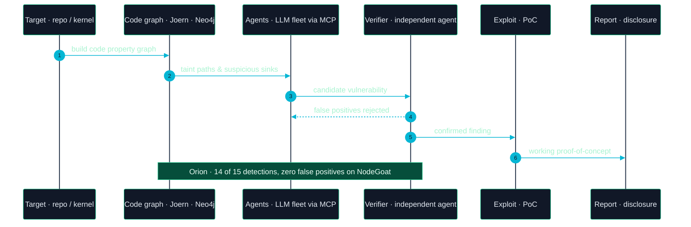
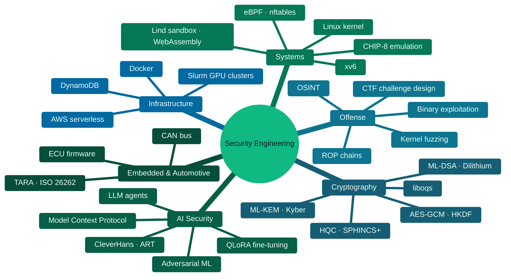
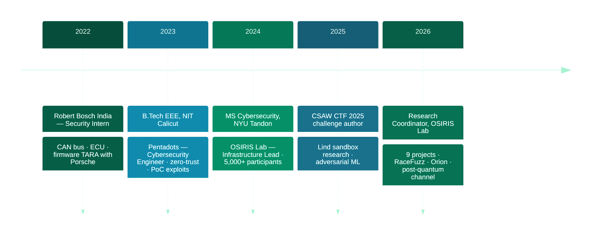

```bash
$ whoami
```

```yaml
name:        Love Kush Pranu
role:        Cybersecurity Engineer · Research Coordinator & Infrastructure Lead
focus:       kernel fuzzing, AI-driven vulnerability discovery, post-quantum crypto
based_in:    Brooklyn, NY · lovekushpranu.com
currently:   NYU OSIRIS Lab — coordinating 9 security research projects, leading RaceFuzz
also:        MS Cybersecurity @ NYU Tandon ('26) · GPA 3.9/4.0
credentials: CompTIA Security+ · CompTIA CySA+ · CCNA (in progress)
ctf:         CSAW CTF 2025 challenge author · OSIRIS CTF team
reachable:   lp2989@nyu.edu · linkedin.com/in/lovekush-pranu
```

<p>
  <a href="https://github.com/lutherleo"></a>
  <a href="https://www.linkedin.com/in/lovekush-pranu/"></a>
  <a href="https://lovekushpranu.com/"></a>
  <a href="mailto:lp2989@nyu.edu"></a>
  <a href="https://x.com/Lovekush_pranu"></a>
</p>

---

### &nbsp;❯&nbsp; What I build

<table>
<tr>
<td width="33%" valign="top" align="center">

**Bug-Hunting Machines**

<sub>Fuzzers and agentic scanners that find real bugs — kernel races, shell-injection RCEs — and prove them with working exploits.</sub>

</td>
<td width="33%" valign="top" align="center">

**Hardened Low-Level Systems**

<sub>Kernels, sandboxes, emulators and secure channels in C, Go and Rust — ASLR, W^X, post-quantum handshakes.</sub>

</td>
<td width="33%" valign="top" align="center">

**Security Research Infrastructure**

<sub>Serverless AWS platforms for 5,000+ participants, Slurm-backed GPU grading and CTF hosting at global scale.</sub>

</td>
</tr>
</table>

---

### &nbsp;❯&nbsp; How a bug moves through my pipeline



---

### &nbsp;❯&nbsp; Engineering principles

> **Break it to build it better.** Every system I ship gets attacked by me first — my own protocols, my own kernels, my own challenges.

> **A finding without a PoC is a rumor.** Detections are verified independently and backed by a working exploit before they count.

> **Go one layer deeper.** From CAN bus and firmware to the Linux network stack — the interesting bugs live below the abstraction.

---

### &nbsp;❯&nbsp; Technology ecosystem



<sub>Primary languages &nbsp;→&nbsp; <code>Python</code> · <code>C</code> · <code>Go</code> · <code>Rust</code> · <code>Bash</code> &nbsp;&nbsp;·&nbsp;&nbsp; Also in production &nbsp;→&nbsp; <code>C++</code> · <code>C#</code> · <code>TypeScript</code> · <code>Perl</code> · <code>PyTorch</code> · <code>TensorFlow</code> · <code>Neo4j</code> · <code>Joern</code> · <code>AWS</code> · <code>Git</code></sub>

---

### &nbsp;❯&nbsp; Career journey



| Period | Company | Role | Key impact |
|:--|:--|:--|:--|
| **Sep 2024 — now** | NYU OSIRIS Lab | Research Coordinator & Infrastructure Lead | Serverless AWS architecture for 5,000+ participants · Slurm-backed GPU grading pipeline · 9 research projects coordinated |
| **Sep 2023 — Jan 2025** | Pentadots Solutions | Cybersecurity Engineer | PoC exploit code & automation across 5+ production deployments · zero-trust frameworks, 30% defense-efficiency gain |
| **Jun 2022 — Aug 2022** | Robert Bosch India Ltd. | E-Drive System Security Intern | CAN bus, ECU & firmware attack surfaces · TARA with Porsche engineering against ISO 26262 · 25% higher validation coverage |

---

### &nbsp;❯&nbsp; Featured engineering projects

<details open>
<summary><b>Orion</b> &nbsp;—&nbsp; GraphRAG code-security scanner with a fleet of verifying agents &nbsp;·&nbsp; <a href="https://github.com/lutherleo/orion">repo</a></summary>

<br>

Multi-agent LLM system that reasons over a **Joern code property graph in Neo4j** through the Model Context Protocol. Discovery agents propose vulnerabilities; independent agents verify them. **14 of 15 detections at zero false positives** on NodeGoat, and a **shell-injection RCE** found in a **160,000-node** production TypeScript repository — with proof-of-concept exploits. Covered by **26 unit tests**.

```mermaid
%%{init: {"theme":"base","themeVariables":{"darkMode":true,"background":"#0F172A","git0":"#10B981","gitBranchLabel0":"#0F172A","primaryColor":"#111827","primaryBorderColor":"#10B981","primaryTextColor":"#E2E8F0","secondaryColor":"#064E3B","secondaryBorderColor":"#34D399","secondaryTextColor":"#ECFDF5","tertiaryColor":"#0B1220","tertiaryBorderColor":"#06B6D4","tertiaryTextColor":"#E2E8F0","mainBkg":"#111827","nodeBorder":"#10B981","clusterBkg":"#0B1220","clusterBorder":"#1E293B","lineColor":"#06B6D4","textColor":"#A7F3D0","edgeLabelBackground":"#0F172A","actorBkg":"#111827","actorBorder":"#10B981","actorTextColor":"#E2E8F0","actorLineColor":"#334155","signalColor":"#06B6D4","signalTextColor":"#A7F3D0","labelBoxBkgColor":"#111827","labelBoxBorderColor":"#10B981","labelTextColor":"#E2E8F0","loopTextColor":"#A7F3D0","noteBkgColor":"#064E3B","noteBorderColor":"#34D399","noteTextColor":"#ECFDF5","activationBkgColor":"#047857","activationBorderColor":"#34D399","sequenceNumberColor":"#0F172A","cScale0":"#064E3B","cScaleLabel0":"#ECFDF5","cScalePeer0":"#34D399","cScale1":"#0E7490","cScaleLabel1":"#ECFDF5","cScalePeer1":"#34D399","cScale2":"#047857","cScaleLabel2":"#ECFDF5","cScalePeer2":"#34D399","cScale3":"#155E75","cScaleLabel3":"#ECFDF5","cScalePeer3":"#34D399","cScale4":"#065F46","cScaleLabel4":"#ECFDF5","cScalePeer4":"#34D399","cScale5":"#0369A1","cScaleLabel5":"#ECFDF5","cScalePeer5":"#34D399","cScale6":"#064E3B","cScaleLabel6":"#ECFDF5","cScalePeer6":"#34D399","cScale7":"#0E7490","cScaleLabel7":"#ECFDF5","cScalePeer7":"#34D399","cScale8":"#047857","cScaleLabel8":"#ECFDF5","cScalePeer8":"#34D399","cScale9":"#155E75","cScaleLabel9":"#ECFDF5","cScalePeer9":"#34D399","cScale10":"#065F46","cScaleLabel10":"#ECFDF5","cScalePeer10":"#34D399","cScale11":"#0369A1","cScaleLabel11":"#ECFDF5","cScalePeer11":"#34D399"}}}%%
flowchart LR
    A[("Source repo<br>160K-node graph")] --> B["Joern CPG<br>→ Neo4j"]
    B --> C["MCP tools<br>graph queries"]
    C --> D["Discovery agents"]
    D --> E["Verifier agents"]
    E --> F["PoC exploit<br>14/15 · 0 FP"]
    style A fill:#064E3B,stroke:#34D399,color:#ECFDF5
    style F fill:#164E63,stroke:#06B6D4,color:#ECFDF5
```



<sub>`Python` `LLM agents` `MCP` `Neo4j` `Joern` `GraphRAG`</sub>

</details>

<details>
<summary><b>RaceFuzz</b> &nbsp;—&nbsp; race-condition fuzzer for the Linux network stack &nbsp;·&nbsp; OSIRIS Lab project I lead</summary>

<br>

Semantic fuzzing framework targeting race conditions in the Linux kernel's TCP stack. A **Go orchestrator** drives a **C kernel module over generic netlink**, combining coverage-guided mutation, Go-based corpus generation and concurrency analysis. Authored **16 race templates** across BPF, nftables and net/sched.


<sub>`Go` `C` `Linux kernel` `TCP/IP` `Generic netlink` `BPF`</sub>

</details>

<details>
<summary><b>Kyber Crystals</b> &nbsp;—&nbsp; one secure channel, two post-quantum families &nbsp;·&nbsp; <a href="https://github.com/lutherleo/Quantum-safe-Kyber-Crystals">repo</a></summary>

<br>

Research-grade post-quantum secure channel in C, implemented twice behind one pluggable backend: **ML-KEM-768 + ML-DSA-65** and lattice-free **HQC-192 + SLH-DSA (SPHINCS+)**. Both sealed with AES-256-GCM and HKDF-SHA256, then attacked and benchmarked in a unified Docker harness at **NIST PQ Category 3**.

<sub>`C` `liboqs` `ML-KEM` `ML-DSA` `SPHINCS+` `AES-GCM` `Docker`</sub>

</details>

<details>
<summary><b>Gemma Intrusion Detection</b> &nbsp;—&nbsp; LLM fine-tuning pipeline for network IDS</summary>

<br>

Machine learning pipeline that fine-tunes Google's **Gemma** LLM on the **UNSW-NB15** intrusion-detection dataset using **QLoRA** with Unsloth.

<sub>`Python` `PyTorch` `Unsloth` `QLoRA`</sub>

</details>

<details>
<summary><b>xv6 Security Enhancements</b> &nbsp;—&nbsp; hardening a teaching kernel &nbsp;·&nbsp; <a href="https://github.com/lutherleo/xv6-OS">repo</a></summary>

<br>

Kernel-level hardening of xv6: **ASLR**, **W^X** memory policies, stack canaries, process isolation and custom system calls for security auditing — alongside OS security research in Rust on the **Lind sandbox** (WebAssembly-based POSIX sandbox) at NYU Tandon.

<sub>`C` `xv6` `ASLR` `W^X` `Rust` `WebAssembly`</sub>

</details>

<details>
<summary><b>Adversarial Robustness in DNNs</b> &nbsp;—&nbsp; validating Madry et al. (2018)</summary>

<br>

PGD adversarial training on MNIST, re-engineering TensorFlow 1.x code for 2.x so CleverHans and ART experiments could run. **~90% accuracy** against PGD and FGSM, with weaknesses identified under C&W attacks and distribution shift.

<sub>`Python` `TensorFlow` `CleverHans` `ART`</sub>

</details>

<details>
<summary><b>CHIP-8 Emulator</b> &nbsp;—&nbsp; from scratch in C &nbsp;·&nbsp; <a href="https://github.com/lutherleo/CHIP-8_emulator">repo</a></summary>

<br>

All **35 opcodes**, 64×32 XOR sprite rendering, SDL2 graphics and input, delay/sound timers and a 16-key hex keypad.

<sub>`C` `SDL2` `CPU emulation`</sub>

</details>

---

### &nbsp;❯&nbsp; Impact at a glance

<table>
<tr>
<td align="center" width="20%"><b>14 / 15</b><br><sub>detections · zero false positives</sub></td>
<td align="center" width="20%"><b>160K</b><br><sub>node repo · RCE found</sub></td>
<td align="center" width="20%"><b>5,000+</b><br><sub>participants on infra I built</sub></td>
<td align="center" width="20%"><b>16</b><br><sub>kernel race templates</sub></td>
<td align="center" width="20%"><b>9</b><br><sub>research projects coordinated</sub></td>
</tr>
</table>

---

### &nbsp;❯&nbsp; GitHub

<!-- animated contribution graph + stats card, built from real data.
     regenerated daily by .github/workflows/update-profile-art.yml
     (scripts/fetch_contributions.py → render_heatmap_svg.py → render_stats_svg.py) -->

<div align="center">

<h3><code>lovekush@github ~ $ ./contributions.sh</code></h3>


<br>
<br>

<h3><code>lovekush@github ~ $ ./stats.sh</code></h3>



</div>

---

### &nbsp;❯&nbsp; Currently exploring

```text
→ semantic fuzzing for concurrency bugs in the Linux network stack
→ agentic vulnerability discovery with independent verification
→ post-quantum protocol design beyond lattices
```

---

<div align="center">

```bash
$ reach me
→ email     lp2989@nyu.edu
→ linkedin  linkedin.com/in/lovekush-pranu
→ web       lovekushpranu.com
→ github    github.com/lutherleo
```

<sub>Open to security engineering, vulnerability research and systems security roles.</sub>

</div>
